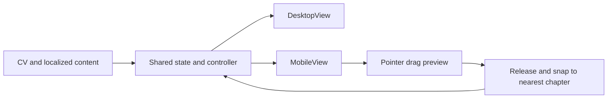

# Approved separate mobile layout and draggable arc

Remove the redundant footer hint/chapter count/previous-next chapter controls on
both layouts. Retain contact links and project/detail pagination. Desktop retains
its left-hand arc. Mobile gets a separate view and bottom drag surface, using the
same CV, locale, appearance and navigation state as desktop.

During drag, the ring and chapter positions follow the finger through one update
per animation frame; labels stay upright, content and selection stay unchanged.
Release snaps to the nearest chapter at the top and navigates once. Clamp at the
first/last chapter, distinguish tap from drag, suppress the post-drag synthetic
click, and cancel safely on pointer cancellation, preference change or remount.
Off-arc entries are hidden until rotated into view; visible taps and keyboard
arrow/Home/End navigation remain available. Reduced motion skips automatic snap
animation while preserving direct finger-controlled movement.

- [x] Pure drag math tests before implementation.
- [x] Separate shared fragments, DesktopView and MobileView; remount only at the
  breakpoint and dispose old local listeners, gestures and animations.
- [x] Remove redundant DOM, event bindings, CSS and UI copy for the footer row.
- [x] Implement pointer capture, RAF tracking, snap, cancellation and tap handling.
- [x] Verify 1,248 content states across four language/theme combinations and
  10 viewports; 22 unit tests; 300 mobile selections using visible taps and keyboard.
- [x] Verify 96 sequential native touch drags across four language/theme
  combinations and three mobile sizes, plus inner-disc dragging, end clamps,
  live preview, nearest snap, cancellation, responsive remount, animated re-grab,
  rapid taps during page turns and preference changes while dragging.
- [x] Existing appearance/localization, wheel and motion suites pass. Focused
  independent reviews found no important issue in the final pointerup-based tap
  routing, capture handling or view lifecycle.
- [x] Capture mobile demo and commit verified source.
- [ ] Confirm before main push, which triggers GitHub Pages deployment.
